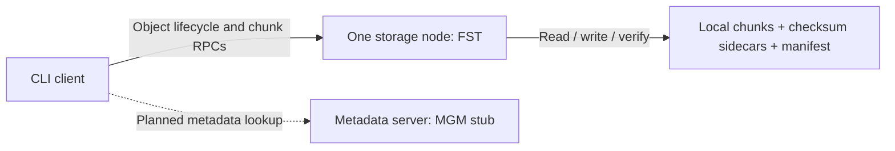

# Distributed Object Store

[](https://github.com/IV-cmd/distributed-object-store/actions/workflows/ci.yml)

An independent, EOS-inspired C++20 learning project. One storage node currently
stores objects as checksummed files and serves them over gRPC. Replication and
erasure coding are planned, **not implemented**. This is not CERN EOS or an
affiliated implementation.

## Architecture



The data path is `client → FST → disk`; MGM is not involved. The separate `mgm`
binary retains its registration handler and unimplemented placement methods.
FST does not register with MGM or perform background work.

## What exists

- C++20 `fst`, `client`, and `mgm` executables; CMake-generated Protobuf/gRPC code.
- Fixed 1 MiB chunks, shared chunking and xxHash64 code, read/write verification.
- Write-once object IDs, local size/chunk-count manifests, explicit upload finish.
- `client put`, `get`, and `rm` talking directly to one configured FST.
- GoogleTest unit and real-gRPC integration tests, including corrupt stored bytes.
- A one-FST Compose environment with a persistent named volume.
- GCC/Clang builds, clang-format/clang-tidy, and container checks in Actions.

See [storage layout and protocol](docs/storage-layout.md) for formats, status
codes, and limits. xxHash64 detects accidental corruption, not malicious changes.

## Build and test

Ubuntu 24.04 is the reference environment. Requires CMake >= 3.24, GCC 13 or
Clang 18, gRPC/Protobuf, xxHash, and GoogleTest. CMake uses installed packages;
it does not download source dependencies.

```sh
sudo apt-get update
sudo apt-get install -y g++ cmake ninja-build libgrpc++-dev libprotobuf-dev \
  protobuf-compiler protobuf-compiler-grpc libgtest-dev libxxhash-dev
cmake -S . -B build -G Ninja -DCMAKE_BUILD_TYPE=Debug
cmake --build build --parallel 2
ctest --test-dir build --output-on-failure
```

Select Clang with `-DCMAKE_CXX_COMPILER=clang++-18` in a fresh build directory.
Use `-DBUILD_TESTING=OFF` for a server/client-only build. Generated sources stay
in the build tree. Tests bind ephemeral loopback ports and use temporary data.

## Run one storage node

Requires Docker Engine, Compose **v2.20+**, and Make. The root Compose file
includes the definition in `docker/`.

```sh
make dev                       # docker compose up --build -d
printf 'hello object store\n' > example.txt
docker compose cp example.txt fst:/tmp/input

docker compose exec -T fst client put /tmp/input example
docker compose exec -T fst client get example /tmp/output
docker compose cp fst:/tmp/output ./output.txt
cmp example.txt output.txt
docker compose exec -T fst client rm example

make logs
make down
```

The FST runs as an unprivileged user, stores data at `/var/lib/objectstore`,
and publishes `127.0.0.1:50052`. The named volume survives `make down`;
`docker compose down --volumes` explicitly destroys it. Set `FST_PORT` to change
the host port. These are insecure development channels: **no TLS or auth**.

### Without containers

```sh
# Terminal 1
./build/src/fst/fst 127.0.0.1:50052 ./data
# Terminal 2
./build/src/client/client put example.txt example
./build/src/client/client get example output.txt
./build/src/client/client rm example
```

`fst [listen_address] [data_dir]` defaults to `127.0.0.1:50052` and `./data`.
`FST_ADDRESS` configures the client endpoint (default `127.0.0.1:50052`).
CLI exit codes: 0 = success, 1 = RPC/local I/O error, 2 = invalid usage.
Stop the server with Ctrl-C. Run only one FST process per data directory.

Uploads reserve an ID until removed, even if interrupted; use `client rm` before
retrying a failed upload. Downloads replace the output only after all chunks
verify. A hard-killed client can leave `<out_file>.download`; remove that stale
directory before retrying. Do not modify an input file during upload or delete
and reuse an object ID during a download.

## Verification and lint

```sh
make smoke
```

This builds the image, starts one FST in an isolated Compose project, exercises
multi-chunk and empty-file CLI round-trips, checks deletion, flips a stored byte,
and requires `DATA_LOSS` / `CHECKSUM_MISMATCH`. It removes its own test volume.
Actions saves its output as the `compose-smoke` artifact.

```sh
sudo apt-get install -y clang-18 clang-format-18 clang-tidy-18
git ls-files -z '*.cc' '*.h' | xargs -0 clang-format-18 -i
git diff --exit-code
cmake -S . -B build-lint -G Ninja -DCMAKE_CXX_COMPILER=clang++-18
cmake --build build-lint --target objectstore_proto --parallel 2
git ls-files -z '*.cc' | xargs -0 clang-tidy-18 -p build-lint
```

## Layout

```text
proto/            RPC definitions and code generation
src/common/       Shared 1 MiB chunking and xxHash64 checksums
src/fst/          Disk storage, manifest lifecycle, gRPC service and server
src/client/       File transfers and CLI
src/mgm/          Separate metadata-server stub
tests/            GoogleTest unit and gRPC integration tests
docker/           Dockerfile and single-node Compose definition
scripts/          Container smoke check
docs/             Storage format and protocol documentation
```

## Roadmap / not yet done

- MGM placement, persistent metadata, and node registry
- Three-way replication and Reed-Solomon (4+2) erasure coding
- Failure detection, node drain, and re-replication
- Background scrubber and repair
- Multi-node/network fault injection and benchmarks
- Authentication, TLS, and crash-safe durable commits

No availability, power-loss durability, throughput, or EOS compatibility claims.
MIT licensed; see [LICENSE](LICENSE).
