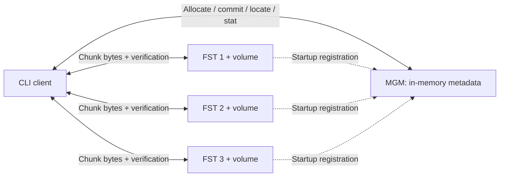

# Distributed Object Store

[](https://github.com/IV-cmd/distributed-object-store/actions/workflows/ci.yml)

An independent, EOS-inspired C++20 learning project: an in-memory metadata server
(MGM), three storage nodes (FSTs), and a gRPC client. Each nonempty file's chunks
are written to three distinct FSTs. Reads locate replicas through MGM and fall
back when a replica is unavailable or fails verification. This is not CERN EOS
or an affiliated implementation. Erasure coding is **not implemented**.

## Architecture



MGM owns the file-to-chunk-to-node map; **file bytes do not pass through MGM**.
The client writes each chunk sequentially to all three targets, records only
acknowledged replicas, and publishes the file only after every chunk has three
copies and all FST manifests finish. A failed upload stays visibly incomplete.

Registration records endpoints and available capacity at startup, **not ongoing
liveness**. Killing an FST causes read fallback; it does not remove that node
from MGM or repair the missing copy. All containers share one physical host.

## What exists

- Fixed 1 MiB chunks and shared xxHash64 verification on writes and reads.
- Write-once IDs, local FST manifests, and MGM file completion.
- Pure deterministic placement selecting distinct node IDs and endpoints.
- In-memory allocation, commit, locate, list, stat, and replica metadata.
- `client put`, `get`, `rm`, `stat`, and `ls`, using an MGM address.
- Partial-write records; verified fallback, including corrupt response rejection.
- GoogleTest unit and real-gRPC tests; one GCC/test/format job on code changes.

See [replication protocol and limits](docs/replication.md) and
[on-disk format](docs/storage-layout.md). xxHash64 detects accidental corruption;
it is not cryptographic authentication. No benchmark claims are made.

## Build and test

Ubuntu 24.04 is the reference environment. Requires CMake >= 3.24, GCC 13 or
Clang 18, gRPC/Protobuf, xxHash, and GoogleTest. CMake uses installed packages.

```sh
sudo apt-get update
sudo apt-get install -y g++ cmake ninja-build libgrpc++-dev libprotobuf-dev \
  protobuf-compiler protobuf-compiler-grpc libgtest-dev libxxhash-dev
cmake -S . -B build -G Ninja -DCMAKE_BUILD_TYPE=Debug
cmake --build build --parallel 2
ctest --test-dir build --output-on-failure
```

Select Clang with `-DCMAKE_CXX_COMPILER=clang++-18` in a fresh build directory.
Use `-DBUILD_TESTING=OFF` for binaries only. Tests bind ephemeral loopback ports
and use temporary data, including three real FST servers and an MGM.

## Run the replicated store

Requires Docker Engine and Compose **v2.20+**. The root Compose file includes
`docker/docker-compose.yml`. FSTs register at startup; wait for all three
`RegisterNode succeeded` messages before uploading.

```sh
docker compose up --build -d
docker compose logs fst1 fst2 fst3
mkdir -p .objectstore-files
printf 'hello replicated store\n' > .objectstore-files/example.txt
export LOCAL_UID=$(id -u) LOCAL_GID=$(id -g)
docker compose run --rm client put /files/example.txt example
docker compose run --rm client stat example
docker compose run --rm client get example /files/output.txt
md5sum .objectstore-files/example.txt .objectstore-files/output.txt

docker compose kill fst2
docker compose run --rm client get example /files/degraded.txt
cmp .objectstore-files/example.txt .objectstore-files/degraded.txt

docker compose start fst2
# Wait for a new registration message before deleting.
docker compose logs fst2
docker compose run --rm client rm example
```

The optional `client` service mounts `.objectstore-files` at `/files`; its UID/GID
matches the exported host IDs so downloads are writable. FST services keep
separate named volumes and run unprivileged. MGM publishes `127.0.0.1:50051`;
set `MGM_PORT` to change it. Advertised FST names resolve inside Compose, so use
the container client for this stack, not a host-side client.

`make dev`, `make logs`, and `make down` wrap Compose. **MGM metadata is lost on
restart**, even though FST volumes retain bytes. There is no namespace recovery
or automatic re-registration after MGM restarts. For a clean disposable reset,
`docker compose down --volumes` destroys all stored data. Do not use this for
valuable files. Channels have **no TLS or authentication**.

### Without containers

Run these servers concurrently in separate terminals, from the repository root:

```sh
./build/src/mgm/mgm 127.0.0.1:50051
./build/src/fst/fst 127.0.0.1:50052 ./data/fst1 127.0.0.1:50051 fst1 127.0.0.1:50052
./build/src/fst/fst 127.0.0.1:50053 ./data/fst2 127.0.0.1:50051 fst2 127.0.0.1:50053
./build/src/fst/fst 127.0.0.1:50054 ./data/fst3 127.0.0.1:50051 fst3 127.0.0.1:50054
```

Then use `./build/src/client/client put <file> <object_id>`, `get <id> <output>`,
`stat <id>`, `ls`, or `rm <id>`. `MGM_ADDRESS` defaults to `127.0.0.1:50051`.
CLI exit codes: 0 = success, 1 = RPC/local I/O error, 2 = invalid usage.
Each FST needs exclusive ownership of its data directory.

## Verification and lint

```sh
make smoke
```

The isolated smoke stack checks three recorded replicas per chunk, byte equality
and `md5sum`, an actual kill of each FST in turn, corrupted-byte fallback, removal,
empty files, and partial-upload refusal. It deletes only its own test volumes.
The automatic CI workflow runs one GCC build, the tests, and formatting; it
skips documentation-only pushes. In Actions, **Extended checks** is manual:
choose `clang`, `static-analysis`, or `compose` when that extra verification is
useful. The Compose option saves `compose-smoke.log` and propagates failures
through its log pipeline. No correctness tests were removed.

```sh
sudo apt-get install -y clang-18 clang-format-18 clang-tidy-18
git ls-files -z '*.cc' '*.h' | xargs -0 clang-format-18 -i
git diff --exit-code
cmake -S . -B build-lint -G Ninja -DCMAKE_CXX_COMPILER=clang++-18
cmake --build build-lint --target objectstore_proto --parallel 2
git ls-files -z '*.cc' | xargs -0 clang-tidy-18 -p build-lint
```

## Layout and roadmap

`src/mgm` holds metadata and pure placement; `src/fst` holds disk storage;
`src/client` holds transfers and CLI; `src/common` holds chunking/checksums.
`proto`, `tests`, `docker`, `scripts`, and `docs` contain their named concerns.

Not yet implemented: metadata persistence/high availability, load balancing,
capacity-aware placement, failure detection, node drain, re-replication,
Reed-Solomon (4+2) erasure coding, scrubbing, repair, benchmarks, TLS/authentication,
or power-loss durability. Parallel replica writes remain a roadmap item.

MIT licensed; see [LICENSE](LICENSE).
