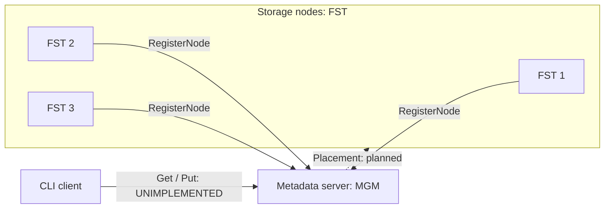

# Distributed Object Store with Replication & Erasure Coding

[](https://github.com/IV-cmd/distributed-object-store/actions/workflows/ci.yml)

An EOS-inspired C++20 learning project for graduate/junior systems roles.
The metadata server (MGM) and storage nodes (FSTs) follow the broad separation
used by CERN EOS. This independent project is not CERN EOS or an affiliated
implementation.

**Foundation only: build skeleton + gRPC plumbing + CI. Not a working object store.**
No objects, metadata, or node registrations are persisted. The title describes
the intended project, not implemented storage features.

## Architecture



Solid arrows are current RPC calls. The dashed arrow is planned; the MGM does
not yet call FSTs or choose chunk placements.

## What exists

- C++20 executables: `mgm`, `fst`, and `client`.
- Protobuf messages and generated gRPC stubs under package `objectstore.v1`.
- MGM `RegisterNode`: validates nonempty node ID/endpoint, logs, and acknowledges.
  It does **not** maintain a node registry or check endpoint reachability.
- MGM `Get`/`Put`: return gRPC `UNIMPLEMENTED` (code 12) with an explicit message.
- MGM `Heartbeat`/`ReportChunkStatus` and all FST methods: generated
  `UNIMPLEMENTED` handlers. No storage, scrubbing, or liveness tracking.
- Each FST serves its RPC interface and registers once on startup. Registration
  waits for MGM readiness with a 15-second deadline; failure exits nonzero.
- GoogleTest smoke tests, container smoke checks, and GitHub Actions CI.

## Layout

```text
proto/            RPC definitions and protobuf/gRPC code generation
src/mgm/          Metadata service and server entry point
src/fst/          Storage-node stub and MGM registration client
src/client/       Get/Put CLI
src/common/       Reserved; no shared code yet
tests/            GoogleTest smoke tests
docker/           Multi-stage Dockerfile and four-container Compose definition
scripts/          Compose smoke check
```

## Build and test

Ubuntu 24.04 is the reference environment. Requires CMake >= 3.24, GCC 13 or
Clang 18, gRPC/Protobuf development packages, and GoogleTest. Dependencies are
installed from Ubuntu packages; CMake does not download source dependencies.

```sh
sudo apt-get update
sudo apt-get install -y g++ cmake ninja-build libgrpc++-dev libprotobuf-dev \
  protobuf-compiler protobuf-compiler-grpc libgtest-dev
cmake -S . -B build -G Ninja -DCMAKE_BUILD_TYPE=Debug
cmake --build build --parallel 2
ctest --test-dir build --output-on-failure
```

To select Clang, add `-DCMAKE_CXX_COMPILER=clang++-18` in a fresh build directory
(after installing `clang-18`). Generated protobuf files stay in the build tree.
For server/client builds without tests, configure with `-DBUILD_TESTING=OFF`.

Smoke tests cover a nested protobuf round-trip, accepted registration, rejected
missing registration fields, and `UNIMPLEMENTED` Get/Put replies over real gRPC
connections to an in-process MGM on an ephemeral loopback port.

## Run the development cluster

Requires Docker Engine, Compose **v2.20 or newer** (for `include`), and Make.
The root Compose file includes the definition in `docker/`.

```sh
make dev
# Equivalent: docker compose up --build -d
# With the modern standalone Compose executable: docker-compose up --build

docker compose ps
docker compose logs mgm fst-1 fst-2 fst-3
```

This starts one MGM plus three separate FST containers on a shared bridge
network. Each FST advertises a distinct DNS endpoint such as `fst-1:50052`.
The same image contains all three executables; the build stage runs `ctest`.
The runtime containers run as an unprivileged numeric user.

```sh
docker compose exec -T mgm client mgm:50051 get example
docker compose exec -T mgm client mgm:50051 put example 42
```

Each command prints `RPC status 12: ... is not implemented yet` and exits 3.
That is an intentional RPC response, **not** a successful object operation.
CLI exit codes: 0 = OK, 1 = other RPC error, 2 = invalid usage, 3 = UNIMPLEMENTED.

```sh
make smoke  # Build, assert all registrations + CLI replies, then remove the stack
make down
```

`make smoke` owns and tears down the Compose project, so do not run it against
a dev stack you want to keep running. These are development-only insecure gRPC
channels: **no TLS or authentication**. Only MGM is published to the host, bound
to `127.0.0.1:50051`; FST ports remain on the Compose network.

### Without containers

In separate terminals:

```sh
./build/src/mgm/mgm 127.0.0.1:50051
./build/src/fst/fst 127.0.0.1:50052 127.0.0.1:50051 fst-1 127.0.0.1:50052
./build/src/client/client 127.0.0.1:50051 get example
```

Stop servers with Ctrl-C. No disk paths, storage volumes, or files are used yet.

## CI and lint

[GitHub Actions](https://github.com/IV-cmd/distributed-object-store/actions/workflows/ci.yml)
builds/tests with GCC and Clang on Ubuntu 24.04, checks Google-style formatting
with clang-format 18, runs clang-tidy 18 on all handwritten `.cc` files, and
runs the four-container RPC smoke check. Compose output is saved as an artifact.
Generated protobuf sources are not formatted or analyzed.

```sh
sudo apt-get install -y clang-18 clang-format-18 clang-tidy-18
# Formatting check (prints a diff and changes only the local working copy):
git ls-files -z '*.cc' '*.h' | xargs -0 clang-format-18 -i
git diff --exit-code
# Static analysis uses a Clang compilation database:
cmake -S . -B build-lint -G Ninja -DCMAKE_CXX_COMPILER=clang++-18
cmake --build build-lint --target objectstore_proto --parallel 2
git ls-files -z '*.cc' | xargs -0 clang-tidy-18 -p build-lint
```

## Roadmap / not yet done

- Object storage and metadata persistence
- Three-way replication
- Reed-Solomon (4+2) erasure coding
- Per-chunk checksums
- Node drain, failure detection, and re-replication
- Background scrubber: corruption detection and repair
- Fault injection: killed nodes, corrupted chunks, and network delays
- Benchmarks: throughput, rebuild time, and degraded-read latency

Later features will be specified individually. No durability, availability,
performance, or EOS compatibility claims are made by the current skeleton.

MIT licensed; see [LICENSE](LICENSE).
