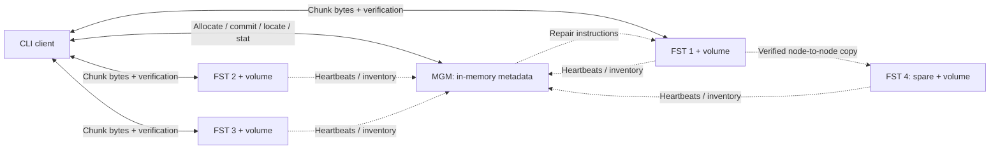
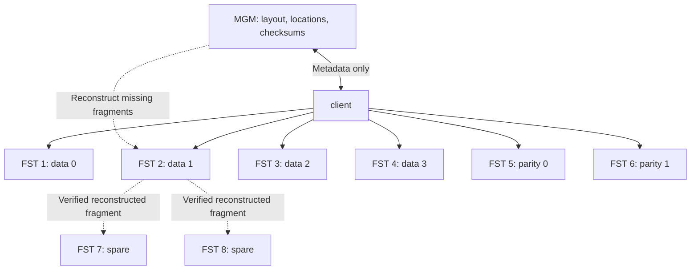

# Distributed Object Store

[](https://github.com/IV-cmd/distributed-object-store/actions/workflows/ci.yml)

An independent, EOS-inspired C++20 learning project: an in-memory metadata server
(MGM), eight storage nodes (FSTs), and a gRPC client. Files use three-way
replication (`replica3`, the default) or Reed-Solomon four-data/two-parity
fragments (`rs42`). Both tolerate two lost holders while enough verified data
survives.
## Architecture



MGM owns the file-to-chunk-to-node map; **file bytes do not pass through MGM**.
For replica3, the client writes each chunk to all three targets, records only
acknowledged replicas, and publishes the file only after every chunk has three
copies and all FST manifests finish. A failed upload stays visibly incomplete.

Heartbeats maintain UP/DOWN state. MGM replaces unavailable copies on a spare
FST using verified node-to-node copying, then reconciles a returning node's
inventory before making it eligible. All containers share one physical host.
See [failure detection and recovery](docs/recovery.md) for timing and limits.

### Erasure-coded layout

Initial RS placement uses six distinct holders; the other two FSTs are spares.
Each larger file is processed in bounded 4 MiB stripes, not buffered whole.



The codec is a from-scratch, systematic Cauchy RS(4,2) construction over GF(256).
It keeps the math inspectable and adds no third-party dependency. The codec has
no I/O, RPCs, or global state; client/FST transfers share one reconstruction
helper. Healthy reads fetch the four data fragments without matrix decoding;
degraded reads need any four checksum-valid fragments. Repair reconstructs
bytes rather than copying an unrelated surviving fragment.

See [erasure coding](docs/erasure-coding.md) for the field arithmetic, padding,
eight-node run instructions, repair protocol, and limits.

## What exists

- At most 1 MiB per stored chunk/fragment; shared xxHash64 verification.
- `replica3` and `rs42`, including verified degraded reads and node-failure repair.
- Write-once IDs, local FST manifests, and MGM file completion.
- Pure deterministic placement selecting distinct node IDs and endpoints.
- In-memory allocation, commit, locate, list, stat, and replica metadata.
- `client put`, `get`, `rm`, `stat`, `ls`, and `nodes`, using an MGM address.
- Partial-write records; verified fallback, including corrupt response rejection.
- GoogleTest unit and real-gRPC tests; one GCC/test/format job on code changes.

See [replication protocol and limits](docs/replication.md) and
[on-disk format](docs/storage-layout.md). xxHash64 detects accidental corruption;
it is not cryptographic authentication. Reproducible fault scenarios and measured
lab results follow below.

## One-command proof runs

Requires Linux, Docker Engine, Compose v2.20+, Make, and Python 3 (standard
library only). Run from the repository root:

```sh
make demo    # upload, stop fst2, restore RF=3 on fst4, download and compare
make chaos   # isolated node-stop, disk-corruption, and network-delay scenarios
make erasure # all 15 loss pairs, corruption, spare repair, isolated three-loss failure
make bench   # both layouts: throughput, degraded reads, stored bytes; replica rebuild
```

Each command builds its images, uses uniquely named disposable Compose projects,
and removes **only its own** containers and test volumes, including on failure.
Do not use these scripts with valuable data. Cold image builds can take over a
minute; the demo's upload/failure/recovery sequence runs after startup.

The normal multi-stage image contains MGM/FST/client and runs as UID 10001.
Only the network scenario selects the optional `fault-tools` image and grants
`NET_ADMIN` to its disposable fst2; the FST process still runs non-root. The
script executes `tc` as root inside that container, adds an egress netem rule,
measures downloads, removes the rule, and checks recovery. This is **not a WAN
model**. If Linux netem/capabilities are unavailable, the scenario prints FAIL
and returns nonzero rather than substituting invented latency results.

Every chaos scenario prints PASS/FAIL; any failure makes `make chaos` fail.
Node-stop samples byte-equal reads during detection, repair, and verified rejoin.
Disk corruption modifies a running FST's real chunk file and requires an explicit
DATA_LOSS rejection plus a byte-equal fallback download. That is reactive read
fallback, **not proactive detection or repair**.

Logs, raw samples, and environment details go under `.proof-results/` (ignored
by Git). In GitHub Actions, manually run **Extended checks → proof** to execute
all four commands and save the `proof-proof` artifact; individual `demo`,
`chaos`, `erasure`, and `bench` choices are also available. Expensive checks stay manual.

## Measured benchmarks

| Object | replica3 write MB/s | rs42 write MB/s | replica3 read MB/s | rs42 read MB/s |
|---|---:|---:|---:|---:|
| 1 MiB | 27.24 | 18.75 | 67.89 | 31.45 |
| 16 MiB | 138.37 | 69.07 | 111.75 | 105.96 |
| 64 MiB | 163.85 | 71.78 | 122.70 | 107.47 |

| 16 MiB read | Healthy | One holder DOWN; no spare |
|---|---:|---:|
| replica3 | 139.88 ms | 137.66 ms |
| rs42 | 160.36 ms | 261.47 ms |

| Object | replica3 payload/file | rs42 payload/file |
|---|---:|---:|
| 1 MiB | 3.000x | 1.500x |
| 16 MiB | 3.000x | 1.500x |
| 64 MiB | 3.000x | 1.500x |

| replica3 64 MiB rebuild | Time |
|---|---:|
| Kill request to DOWN | 4.691 s |
| DOWN to RF=3 | 32.705 s |
| Kill request to RF=3 | 37.396 s |

Measured by [make bench in GitHub Actions](https://github.com/IV-cmd/distributed-object-store/actions/runs/44081355339)
on [source 4f6d08b](https://github.com/IV-cmd/distributed-object-store/commit/4f6d08b79eca92114852b7db7623e729aeca2264).
[Raw samples, stored-byte counts, environment, and timestamps](docs/benchmark-results.json)
are retained in git; the artifact also contains both clusters' logs.

Conditions: Ubuntu 24.04 GitHub-hosted runner, four visible vCPUs, 15.6 GiB RAM,
Intel Xeon Platinum 8370C, Docker 28.0.4/overlay2, Compose 2.38.2. Both layouts
were measured in the same job using separate fresh clusters on one host. These
are short, single-client lab observations, not multi-host performance claims.

Each transfer cell is the median of three trials with a repeating byte pattern,
sequential writes, buffered I/O, warm OS page cache, and **no fsync guarantee**.
MB/s counts original payload bytes once (decimal MB); sizes use binary MiB.
The real Put/Get operation timer includes file I/O, checksums, encoding or
reconstruction, and RPCs, but excludes Docker/process startup. Every download
is compared byte-for-byte with its input. Healthy RS reads skip matrix decoding
but still re-encode for verification against all six MGM fragment checksums.

Degraded reads wait for fst2 to be DOWN with no spare started: replica3 has two
copies per chunk; rs42 has five fragments per stripe and actually decodes the
missing data fragment. The RS latency difference includes reconstruction and
parity verification, not an isolated codec microbenchmark. The slightly lower
replica3 median is noise, not evidence that failure improves performance. Neither
case measures pre-detection timeout costs or reads concurrent with repair.

Storage ratios sum actual `.chunk` file lengths across FSTs before repair,
including RS padding. They exclude filesystem block rounding, Docker layers,
MGM memory, markers, and checksum files; the last two are counted separately
in the raw record. The aligned sizes above give 3x versus 1.5x, not a promise
for tiny objects or post-repair clusters retaining old returning copies.

The separate replica3 rebuild restores a 64 MiB object after losing one copy
of each chunk. The marker precedes Docker stop; DOWN and final completion use
same-host MGM timestamps. Metadata must show three surviving holders. Settings:
2000 ms heartbeat, 6000 ms timeout, 500 ms repair interval, one copy at a time.
Rebuild duration includes deliberate pacing. RS reconstruction-based repair is
verified in [the eight-FST proof](https://github.com/IV-cmd/distributed-object-store/actions/runs/44084029111),
not presented as a measured RS rebuild-throughput benchmark.

## Build and test

Ubuntu 24.04 is the reference environment. Requires CMake >= 3.24, GCC 13 or
Clang 18, gRPC/Protobuf, xxHash, and GoogleTest. CMake uses installed packages.

```sh
sudo apt-get update
sudo apt-get install -y g++ cmake ninja-build libgrpc++-dev libprotobuf-dev \
  protobuf-compiler protobuf-compiler-grpc libgtest-dev libxxhash-dev
cmake -S . -B build -G Ninja -DCMAKE_BUILD_TYPE=Debug
cmake --build build --parallel 2
ctest --test-dir build --output-on-failure
```

Select Clang with `-DCMAKE_CXX_COMPILER=clang++-18` in a fresh build directory.
Use `-DBUILD_TESTING=OFF` for binaries only. Tests bind ephemeral loopback ports
and use temporary data, including replica3 recovery clusters, six-node RS clients, and an MGM.

## Run the replicated store

Requires Docker Engine and Compose **v2.20+**. The root Compose file includes
`docker/docker-compose.yml`. FSTs register at startup; wait for all eight
`RegisterNode succeeded` messages before uploading.

```sh
docker compose up --build -d
docker compose logs fst1 fst2 fst3 fst4 fst5 fst6 fst7 fst8
mkdir -p .objectstore-files
printf 'hello replicated store\n' > .objectstore-files/example.txt
export LOCAL_UID=$(id -u) LOCAL_GID=$(id -g)
docker compose run --rm --no-deps client put /files/example.txt example
docker compose run --rm --no-deps client stat example
docker compose run --rm --no-deps client get example /files/output.txt
md5sum .objectstore-files/example.txt .objectstore-files/output.txt

docker compose stop fst2
docker compose run --rm --no-deps client get example /files/degraded.txt
cmp .objectstore-files/example.txt .objectstore-files/degraded.txt

docker compose start fst2
# Wait until `client nodes` reports fst2 UP after inventory verification.
docker compose logs fst2
docker compose run --rm --no-deps client rm example
```

The optional `client` service mounts `.objectstore-files` at `/files`; its UID/GID
matches the exported host IDs so downloads are writable. FST services keep
separate named volumes and run unprivileged. MGM publishes `127.0.0.1:50051`;
set `MGM_PORT` to change it. Advertised FST names resolve inside Compose, so use
the container client for this stack, not a host-side client.

`make dev`, `make logs`, and `make down` wrap Compose. **MGM metadata is lost on
restart**, even though FST volumes retain bytes. Heartbeats restore the registry
after MGM restarts, but there is no namespace recovery. For a clean disposable reset,
`docker compose down --volumes` destroys all stored data. Do not use this for
valuable files. Channels have **no TLS or authentication**.

### Without containers

Run these servers concurrently in separate terminals, from the repository root:

```sh
./build/src/mgm/mgm 127.0.0.1:50051
./build/src/fst/fst 127.0.0.1:50052 ./data/fst1 127.0.0.1:50051 fst1 127.0.0.1:50052
./build/src/fst/fst 127.0.0.1:50053 ./data/fst2 127.0.0.1:50051 fst2 127.0.0.1:50053
./build/src/fst/fst 127.0.0.1:50054 ./data/fst3 127.0.0.1:50051 fst3 127.0.0.1:50054
./build/src/fst/fst 127.0.0.1:50055 ./data/fst4 127.0.0.1:50051 fst4 127.0.0.1:50055
```

For RS, start four additional FSTs with distinct directories, node IDs, and
endpoints (six holders plus two spares). The container recipe above starts all eight.

Then use `./build/src/client/client put <file> <object_id> [replica3|rs42]`, `get <id> <output>`,
`stat <id>`, `ls`, `nodes`, or `rm <id>`. `MGM_ADDRESS` defaults to `127.0.0.1:50051`.
CLI exit codes: 0 = success, 1 = RPC/local I/O error, 2 = invalid usage.
Each FST needs exclusive ownership of its data directory.

## Failure detection and repair

Defaults: `HEARTBEAT_INTERVAL_MS=2000` on FSTs, `HEARTBEAT_TIMEOUT_MS=6000` and
`REPAIR_INTERVAL_MS=500` on MGM. These are settings, not measured timings.
The worker allows one copy at a time. `stat` counts UP, non-quarantined replicas;
`nodes` exposes node state. Rejoining copies are verified before reuse; excess
valid copies are retained without rebalancing. See [recovery](docs/recovery.md).

## Verification and lint

```sh
make smoke
```

The isolated four-FST smoke stack exercises stop/detection/re-replication,
checksum-verified reads, corrupt/missing/unexpected rejoin data, and a second
failure during copying. It records timestamps and removes its own test volumes.

The automatic CI workflow runs one GCC build, the tests, and formatting; it
skips documentation-only pushes. In Actions, **Extended checks** is manual:
choose `clang`, `static-analysis`, `compose`, or the proof commands above when
that extra verification is useful. The same automatic job also checks harness
assertions, client benchmark usage, and Python/Bash syntax. The Compose option saves `compose-smoke.log` and propagates failures
through its log pipeline. No correctness tests were removed.

```sh
sudo apt-get install -y clang-18 clang-format-18 clang-tidy-18
git ls-files -z '*.cc' '*.h' | xargs -0 clang-format-18 -i
git diff --exit-code
cmake -S . -B build-lint -G Ninja -DCMAKE_CXX_COMPILER=clang++-18
cmake --build build-lint --target objectstore_proto --parallel 2
git ls-files -z '*.cc' | xargs -0 clang-tidy-18 -p build-lint
```

## Honest limits

- **Single MGM is a single point of failure.** No replicated/slave MGM or
  metadata failover is implemented; EOS-style MGM high availability is not
  reproduced here.
- **Metadata is in memory.** Restart loses the namespace, replica map, and file
  completion state. Heartbeats repopulate the node registry, not the namespace;
  existing disk bytes are not automatically rediscovered. Metadata scale is
  bounded by one process's memory.
- **No Raft/consensus or atomic distributed transaction.** Checksums establish
  byte integrity, not distributed consistency. Completion/acknowledgement rules
  do not make metadata fault-tolerant.
- **No TLS, authentication, or encryption at rest.** This is an isolated lab,
  not an Internet-facing service.
- **Minimal rejoin reconciliation, not full anti-entropy.** Full inventories are
  unpaged; unexpected chunks are flagged, and excess valid copies remain.
  There is no automatic rebalance or complete orphan cleanup.
- **No background scrubber.** Reads reject corrupt bytes and try another copy,
  but do not notify MGM or repair that copy. MGM may still list it until later
  inventory or repair-source verification discovers it. In-place corruption
  repair is also absent.
- **RS is deliberately unoptimized.** Table-based GF(256), no SIMD, sequential
  fragment RPCs, and extra padding/sidecars for small objects. It corrects known
  erasures after checksum rejection, not arbitrary undetected errors.
- **No independent host-failure proof or power-loss durability guarantee.**
  Separate Compose volumes still share one host. Sequential replica writes and
  fixed placement are deliberate scope limits.

## Layout and roadmap

`src/mgm` holds metadata and pure placement; `src/fst` holds disk storage;
`src/client` holds transfers and CLI; `src/common` holds chunking/checksums.
`proto`, `tests`, `docker`, `scripts`, and `docs` contain their named concerns.

Not yet implemented: metadata persistence/high availability, load balancing,
capacity-aware placement, a manual node-drain command,
scrubbing, in-place corruption repair, TLS/authentication,
or power-loss durability. Parallel replica writes remain a roadmap item.

MIT licensed; see [LICENSE](LICENSE).
